# 🏥 MediCore: Hospital Management System

A full-stack **Hospital Management System** built with **Flask** and **SQLite** to manage day-to-day hospital operations: patients, doctors, appointments, billing, and prescriptions, all from one clean, responsive dashboard.

🔗 **Live demo:** [amiraaymann.pythonanywhere.com](https://amiraaymann.pythonanywhere.com)

| Demo login | |
|---|---|
| Email | `admin@demo.com` |
| Password | `admin1234` |

> ⚠️ This is a public demo with sample data. The data may be reset at any time.

---

## 📸 Screenshots

| Dashboard (light) | Dashboard (dark) |
|---|---|
| 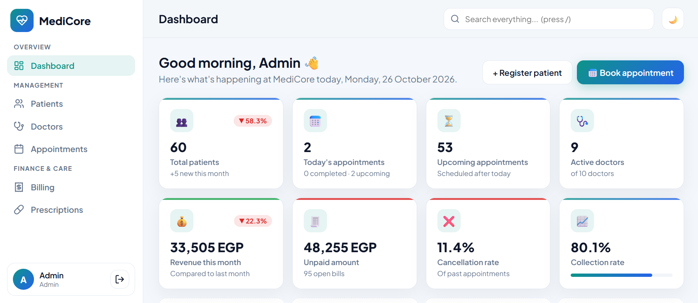 | 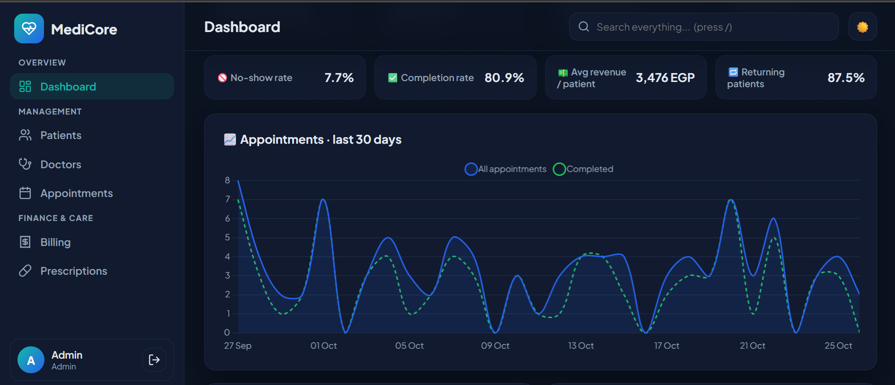 |

| Login | Patient profile & history |
|---|---|
| 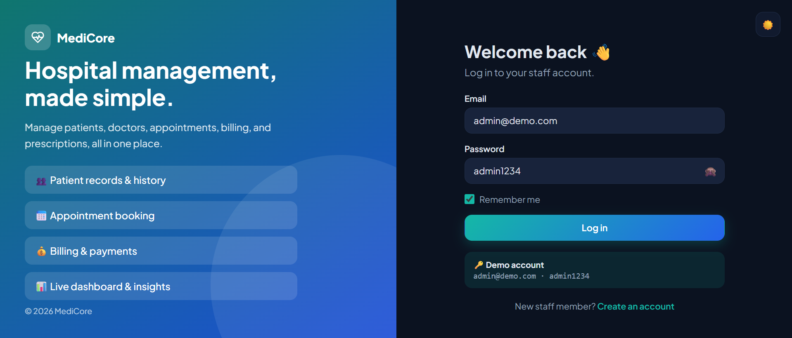 | 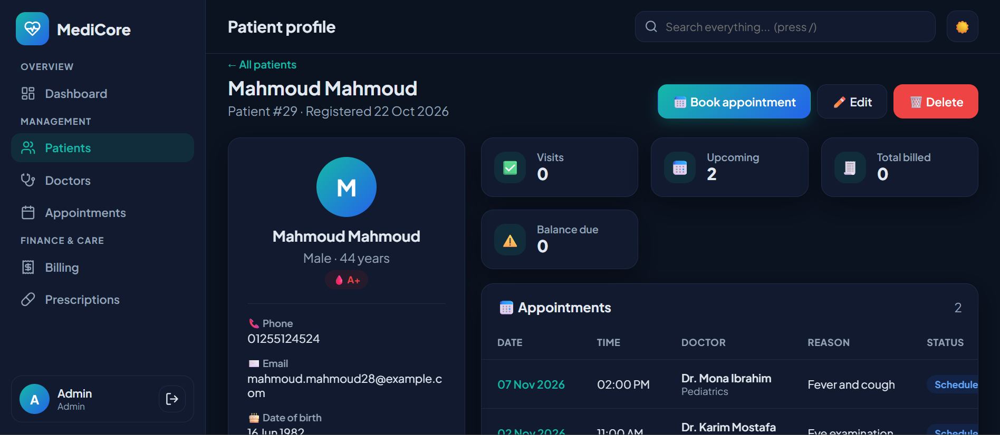 |

| Doctors | Appointment booking (live slots) |
|---|---|
| 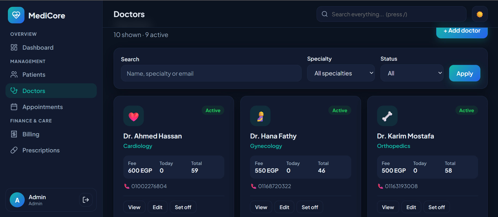 | 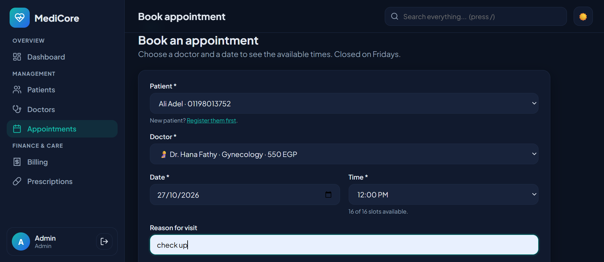 |

| Billing | Printable invoice |
|---|---|
| 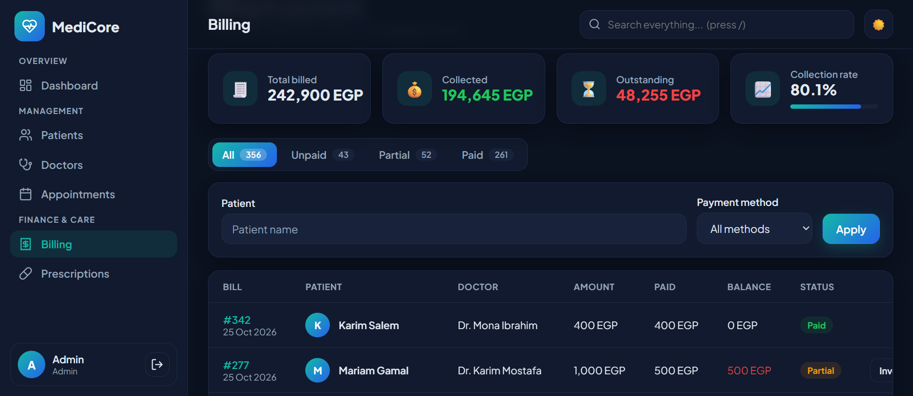 | 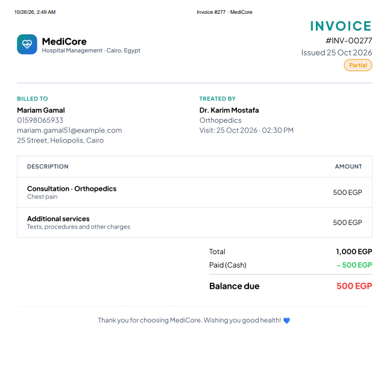 | | 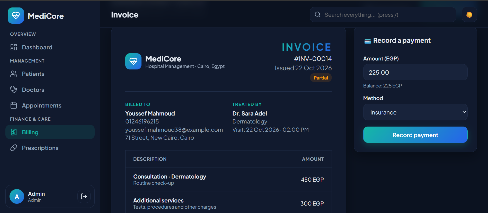 |


| Prescription (℞) | Global search |
|---|---|
| 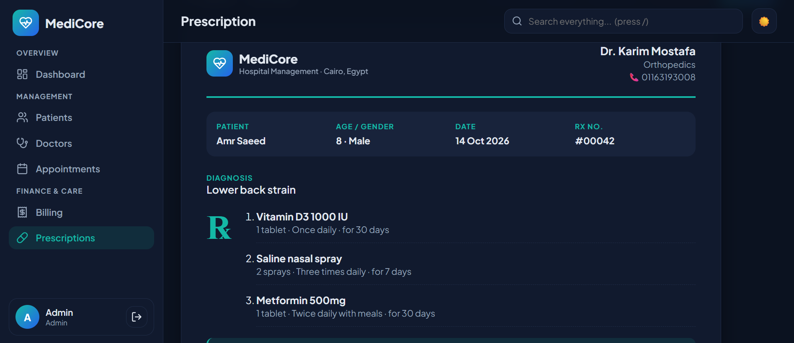 | 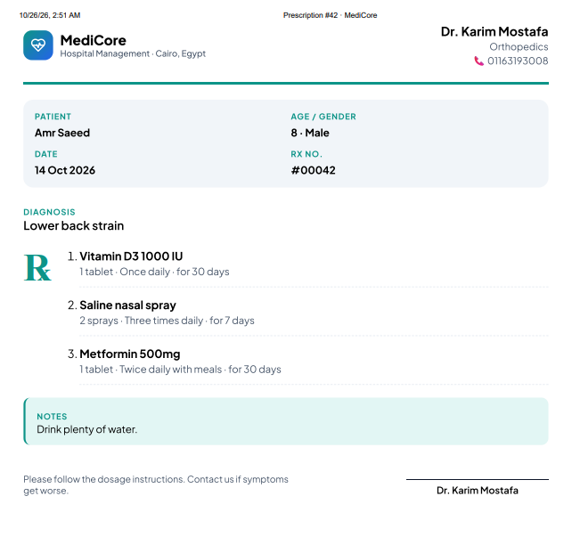 | 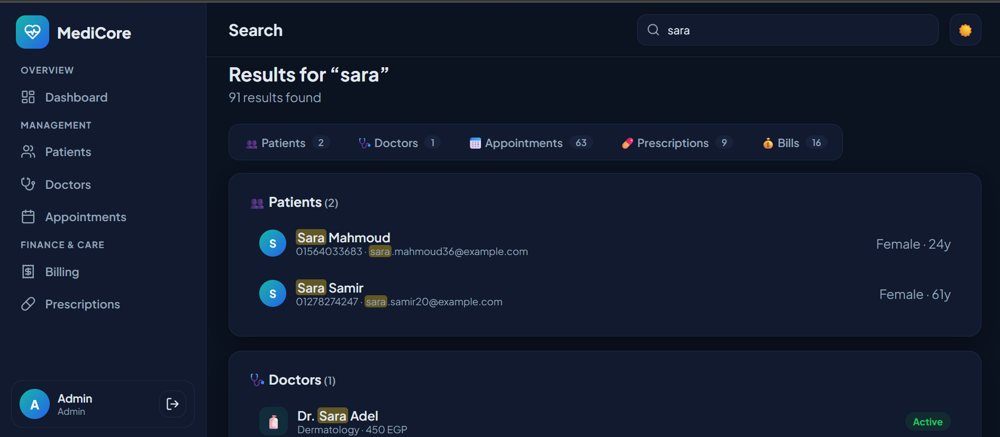 |

| Mobile |
|---|
| 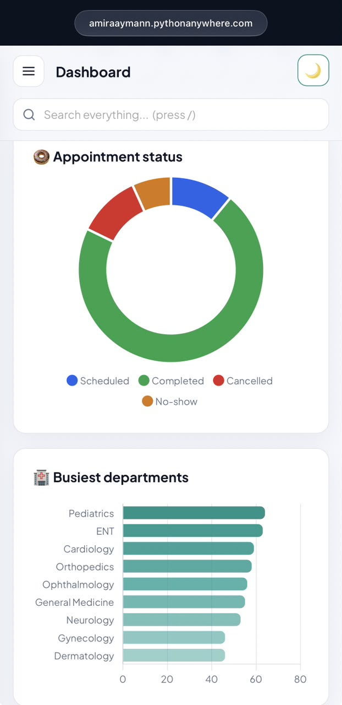 |
| 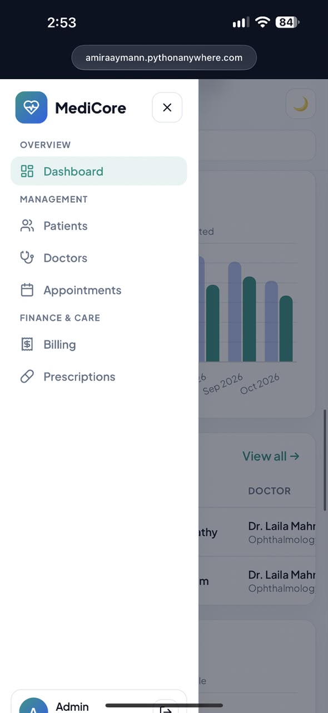 |

---

## ✨ Features

### Core features
| Feature | What it does |
|---|---|
| 📊 **Dashboard** | 8 KPI cards with month-over-month trends, 4 insights, 5 interactive charts (Chart.js), today's schedule, pending payments, top doctors, and new patients |
| 👥 **Patient registration** | Add, edit, delete, search, filter, sort, and paginate patients |
| 🩺 **Doctor management** | Doctor cards with specialty icons, fees, active/off status, and per-doctor stats and revenue |
| 📅 **Appointment booking** | Live available time slots, double-booking protection, closed on Fridays, reschedule, complete, cancel, no-show, and restore |
| 💰 **Billing & payments** | Bills from completed visits, partial and full payments, collection rate, outstanding balances, and printable invoices |
| 🔍 **Search** | One global search across patients, doctors, appointments, prescriptions, and bills, with highlighted matches and `#ID` lookup |
| 📱 **Responsive design** | Works on desktop, tablet, and mobile (slide-in sidebar, scrollable tables) |

### Bonus features
| Feature | What it does |
|---|---|
| 🔐 **Login / Signup** | Secure sign-up and login with hashed passwords, "Remember me", and protected pages. The first account becomes the admin |
| 🛠️ **Admin dashboard** | Live hospital overview: revenue, unpaid bills, cancellation, no-show, and completion rates |
| 📂 **Patient history** | Each patient's full timeline of appointments, bills, and prescriptions on one page |
| 💊 **Prescription management** | Multiple medicines per prescription, medicine suggestions, edit and delete, and a printable ℞ sheet with a signature line |
| 🗄️ **Database integration** | 7 related tables in SQLite through SQLAlchemy, with realistic seed data |
| 🌙 **Dark mode** | Saved per browser, follows the system theme, and the charts recolor automatically |

---

## 🛠️ Tech Stack

| Layer | Technology |
|---|---|
| Backend | Python 3.12, Flask 3 |
| Database | SQLite + Flask-SQLAlchemy |
| Authentication | Flask-Login + Werkzeug password hashing |
| Frontend | HTML (Jinja2 templates), CSS, JavaScript |
| Charts | Chart.js |
| Hosting | PythonAnywhere |

---

## 🗄️ Database Design

```
users                  (staff accounts: admin / staff)
patients ──┬── appointments ──┬── bills
           │                  └── prescriptions ── prescription_items
doctors ───┘
```

| Table | Purpose |
|---|---|
| `users` | Staff who log in (hashed passwords, roles) |
| `patients` | Patient details (contact, date of birth, blood type) |
| `doctors` | Doctors, specialties, consultation fees, status |
| `appointments` | Patient + doctor + date + time + status |
| `bills` | One bill per completed appointment, with payments |
| `prescriptions` | Diagnosis and notes for a completed visit |
| `prescription_items` | Each medicine with its dosage, frequency, and duration |

---

## 🔐 Security Highlights

- Passwords are hashed, never stored as plain text
- Every page requires login (`@login_required`)
- All database queries go through SQLAlchemy (no SQL injection)
- User input is auto-escaped in templates (no XSS), including highlighted search results
- Safe redirects after login (no open redirects)
- Login cookies use `SameSite=Lax` and `HttpOnly`
- Delete, cancel, and payment actions are POST-only, with confirmations
- Server-side rules for appointment status changes and double-booking
- Double-submit protection on forms (no duplicate payments)

---

## 📁 Project Structure

```
hospital-management/
├── app.py               # Flask app: all routes and business logic
├── models.py            # Database models (SQLAlchemy)
├── seed.py              # Generates realistic sample data
├── requirements.txt
├── static/
│   ├── css/style.css    # Design system, dark mode, responsive and print styles
│   └── js/
│       ├── main.js      # Dark mode, sidebar, flash messages, confirmations
│       └── dashboard.js # Dashboard charts
└── templates/
    ├── base.html        # Main layout (sidebar + top bar)
    ├── macros.html      # Pagination + status badges
    ├── dashboard.html
    ├── search.html
    ├── error.html       # 404 / 500 pages
    ├── auth/            # Login + signup
    ├── patients/        # List, form, profile
    ├── doctors/         # List, form, profile
    ├── appointments/    # List, form, details
    ├── billing/         # List, create bill, invoice
    └── prescriptions/   # List, form, ℞ sheet
```

---

## 🚀 Run Locally

**1. Clone the repository**
```bash
git clone https://github.com/meroaymann/medicore-hospital-management.git
cd medicore-hospital-management
```

**2. Create a virtual environment and install the libraries**
```bash
python -m venv venv

# Windows
venv\Scripts\activate
# macOS / Linux
source venv/bin/activate

pip install -r requirements.txt
```

**3. Create a `.env` file** in the project folder
```
SECRET_KEY=your-own-random-secret-key
```
Generate a random key with:
```bash
python -c "import secrets; print(secrets.token_hex(32))"
```

**4. Fill the database with sample data**
```bash
python seed.py
```
Type `YES` to confirm (or run `python seed.py --yes` to skip the question).

**5. Start the app**
```bash
python app.py
```
Open **http://127.0.0.1:5000** and log in with `admin@demo.com` / `admin1234`.

---

## 👩‍💻 Author

**Amira Ayman**: Computer Science graduate (Data Science), German International University, Cairo

Built as **Task 2** of my Python Programming Internship at **Sqrock IT Solutions**.

- GitHub: [@meroaymann](https://github.com/meroaymann)